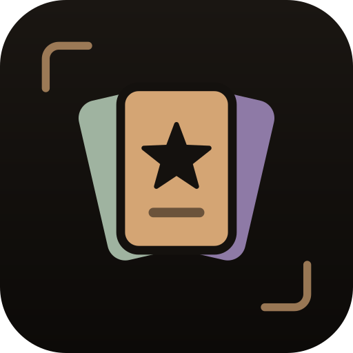
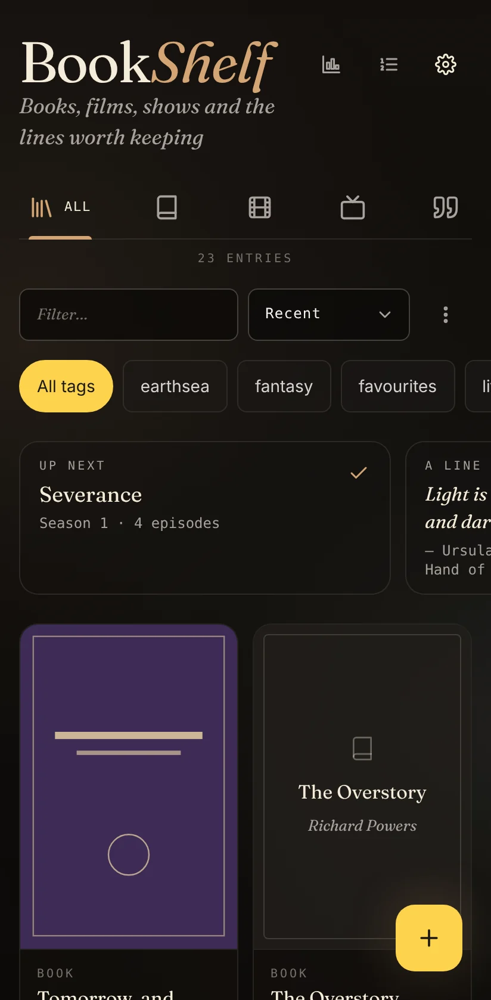

<p align="center"></p>

<h1 align="center">BookShelf</h1>

<p align="center"><em>Books, films, shows and the lines worth keeping.</em></p>

<p align="center">
  Android 10+&nbsp;·&nbsp;<a href="https://github.com/not-mehul/BookShelf/releases/latest">Latest release</a>&nbsp;·&nbsp;MIT&nbsp;·&nbsp;Created by <strong>Mehul Sen</strong>
</p>

---

BookShelf is a catalog of everything you read and watch: books, films, TV shows, and the quotes you want to keep. Add something in a few taps, rate it, and it's dated as you start and finish it. Years later you can still find it, along with what you thought of it. It is deliberately not a tracker: no page counts, no goals, nothing to keep up with. It's an Android app, and your library lives on your phone.

<p align="center">
  
  
  
  
</p>

## What it does

### Add anything

- **Books** from Google Books, with Open Library as a fallback, by title, ISBN or a **scanned barcode**.
- **Films and TV** from [TMDB](https://www.themoviedb.org), straight from your phone with your own free key. The director, creators, genres and runtime fill in when you open an entry.
- **Quotes**, with the author, the source and a page or time, linked to the book, film or show they come from.
- **By hand**, when search comes up empty. Anything can be edited later.
- **Shared from another app**: a highlight, title or link sent through the Android share sheet opens a filled-in quote or search.

### Keep a record

- **Status at a tap**: Wishlist, Reading or Watching, Finished, or Did not finish.
- **Ratings** in half stars, or out of 10 with half points (Settings → Ratings; both read the same ratings). Aspect scores sit right under the rating: story, writing, characters and pacing for a book; acting, direction and visuals for a film.
- **A journal that writes itself.** Starting, finishing and putting something down are dated as they happen. A book's start and finish are picked together on one calendar, and finishing again keeps every date.
- **TV by season.** One toggle per season marks its aired episodes. _Up next_ names the next season to watch, or says when an unaired one airs. **New-episode alerts** keep checking TMDB while the app is closed.
- **Series**, from titles, TMDB collections or set by hand, in reading or watching order, with what's next and any gaps.
- **A queue** for the wishlist, reordered by dragging, plus _Pick for me_ by type or genre.
- **Notes, tags and bulk edits.** Select several entries to change their status, add or remove tags, or delete them; a delete can be undone.

### Look back

- **Statistics**: the year in review (finished per month, pages read, hours watched, the longest book and the highest rated), then the whole shelf (totals, ratings, most-shelved authors and directors, decades and genres).
- **Share cards**: any book, film, show or quote as an image in the Dusk or Dawn style (post, square or story), or as text.
- **Little things.** A different kept quote heads the library each day, the library remembers its tab, sort and layout, and finishing something earns a little confetti. There's also an idle cat, and four easter eggs, counted in Settings.

### Keep it safe

- **Encrypted backup** to a folder that Google Drive, Nextcloud or Syncthing keeps. It runs daily, weekly or monthly (checked whenever the app opens), or only when you tap _Back up now_. Every phone that backs up to the same folder stays in step, and edits to different parts of one entry on two phones are both kept.
- **Bring your shelf over** from Goodreads or StoryGraph (their CSV) or Letterboxd (the export zip as it is), with ratings, shelves, read dates, reviews and tags. Importing twice adds nothing.
- **Library refresh** checks every entry that's missing a cover, synopsis, details or a catalog match, with a progress bar, then lists what it found:
  - sure matches, ticked and ready to update;
  - possible matches to choose from;
  - anything not found, to search for or leave as it is.

  Only what was missing is filled in, and nothing you wrote changes. **Find a match** does the same for a single entry.

- **Duplicate check** finds two copies of the same thing and merges them, keeping what you wrote on either.
- **Restore** a BookShelf backup file; restoring the same file again never duplicates.

### Around the phone

- **A home-screen widget**: what you're reading and watching, your shelf count and latest quote, and a **✓ S2 E4** button that marks the next episode watched without opening the app.
- **Links from the other apps.** `bookshelf://log?title=…&author=…` searches for a book and adds the one you pick; `bookshelf://quote?text=…&title=…&author=…` opens the quote form filled in; `bookshelf://open` just opens the app.
- **Dusk and Dawn** themes, or follow the system; the shelf as covers or as a list.

## Private by design

Your catalog never leaves the phone. BookShelf talks to a catalog when you search or open an entry, and, for shows with alerts on, asks TMDB about new episodes now and then. If you turn on the backup, it writes one end-to-end encrypted file to the folder you chose. API keys and the backup passphrase are encrypted with a key in the Android Keystore. There are no accounts and no BookShelf server.

## Install

Download the signed APK from the [latest release](https://github.com/not-mehul/BookShelf/releases/latest) and open it on your phone (Android 10 or later).

Then open **Settings → Search → Films and TV** and paste a free **TMDB API key** or read access token: make a TMDB account, then find it under Settings → API on themoviedb.org. BookShelf checks the key with TMDB as you paste it and says whether it works; tap the eye to see what you pasted. A **Google Books API key** is optional and raises the daily search limit. To keep a backup, choose a folder and a passphrase under **Settings → Backup**.

## The Dusk & Dawn apps

BookShelf is one of five apps by Mehul Sen that share one design system, [Editorial Dusk & Dawn](https://github.com/not-mehul/dusk-dawn), and a common link scheme, so they can hand things to each other.

| App                                                 | What it is for                                                            |
| --------------------------------------------------- | ------------------------------------------------------------------------- |
| [Waymark](https://github.com/not-mehul/Waymark)     | Your whole trip, offline: flights, stays, plans and costs on one timeline |
| [BookShelf](https://github.com/not-mehul/BookShelf) | Books, films, shows and the lines worth keeping                           |
| [Ledger](https://github.com/not-mehul/Ledger)       | A record of cities, scored on what matters to you                         |
| [Rosetta](https://github.com/not-mehul/Rosetta)     | A quiet library and reader for books, papers and notes                    |
| [Mise](https://github.com/not-mehul/Mise)           | Recipes from anywhere, cooked one step at a time                          |

## Build from source

Svelte 5 and TypeScript, built by Vite into a single self-contained page, with Dexie for storage and a Capacitor 8 Android app around it. You need Node 22.12 or later.

```sh
npm install
npm run dev          # the UI in a browser, for development (no search, backup or sharing)
npm run check        # tokens, lint, typecheck, unit tests and build
npm run sync         # build, then copy it into the Android project
npm run android:apk  # a debug APK, in android/app/build/outputs/apk/debug/
```

[docs/DEVELOPMENT.md](docs/DEVELOPMENT.md) covers the scripts, the Android app, the project structure, the APIs and the tests. [RELEASING.md](RELEASING.md) covers signing and releases.

## Credits

BookShelf is designed and built by **Mehul Sen** ([@not-mehul](https://github.com/not-mehul)).

- Catalog data: [Google Books](https://books.google.com), [Open Library](https://openlibrary.org) and [TMDB](https://www.themoviedb.org). This product uses the TMDB API but is not endorsed or certified by TMDB.
- Icons: [Lucide](https://lucide.dev), ISC.
- Fonts and design: Fraunces (SIL Open Font License) through [dusk-dawn](https://github.com/not-mehul/dusk-dawn).

## Licence

[MIT](LICENSE) © 2026 Mehul Sen.
