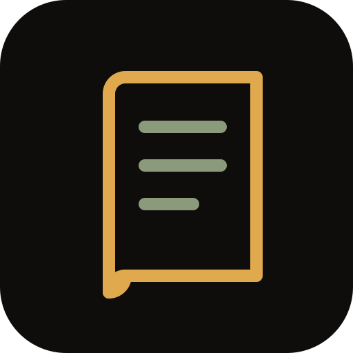
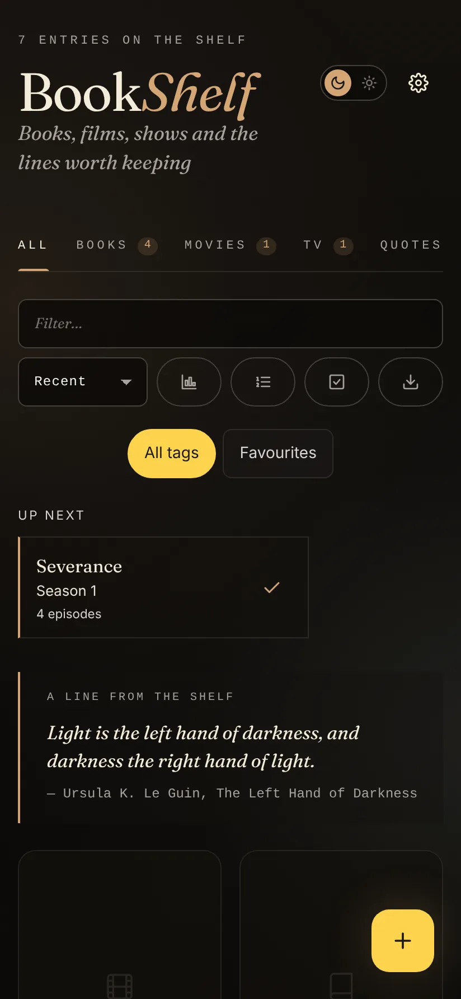
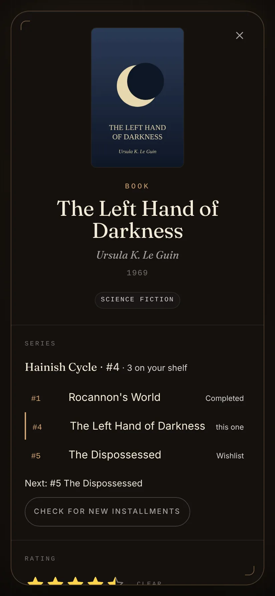
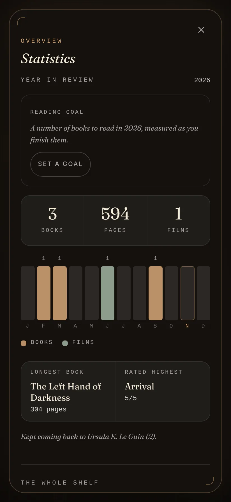
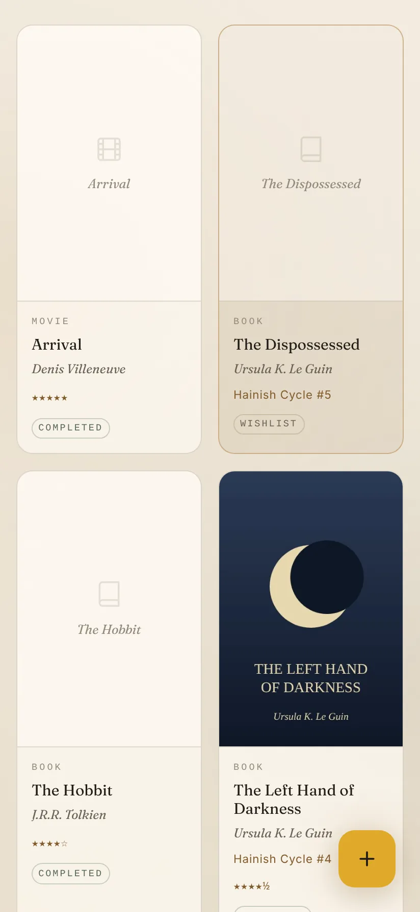

<p align="center"></p>

<h1 align="center">BookShelf</h1>

<p align="center"><em>Books, films, shows and the lines worth keeping.</em></p>

<p align="center">
  Android&nbsp;·&nbsp;Web&nbsp;·&nbsp;<a href="https://github.com/not-mehul/BookShelf/releases/latest">Latest release</a>&nbsp;·&nbsp;MIT&nbsp;·&nbsp;Created by <strong>Mehul Sen</strong>
</p>

---

BookShelf is a personal catalog for the books you read, the films and shows you watch, and the quotes you want to keep. Search for something, rate it, track where you are, and see your year in review. It runs as an Android app and as an installable web app, and the library lives on your device.

<p align="center">
  
  
  
  
</p>

## Features

### Add anything

- **Books** from Google Books, with Open Library as a fallback, by title, ISBN or a **scanned barcode**.
- **Films and TV** from TheTVDB, directly or through your own hosted proxy ([`proxy/`](proxy)), with cast and genres filled in when you open an entry.
- **Quotes** with author, source and page or time, linked to the book, film or show they come from. Each entry lists its quotes.
- **By hand**, when search comes up empty. Every entry can be edited afterwards.
- **Share into BookShelf** a highlight, title or link from any app (the Android share sheet, or the installed web app's share target) to get a prefilled quote or search.

### Keep track

- **Status at a tap.** Three toggles, Wishlist, Reading or Watching, and Completed, each in its own colour.
- **Half-star ratings** with optional aspect scores (story, writing, acting and so on), notes, tags and collections.
- **A reading journal.** Starting and finishing are dated as they happen. A book's span is picked on one calendar (start, then finish), and a film or show takes one day.
- **TV by season.** One toggle per season, _Up next_ names the next one or says when an unaired season airs, and on Android you get **new-episode alerts**.
- **Series**, detected from titles or set by hand, with reading or watching order, what is next, any gaps, and a check for new installments.
- **A ranked queue.** Your wishlist in order (drag, keyboard or buttons), plus _pick something for me_ by type, length or genre.
- **Bulk edit.** Select several entries to change status, add or remove tags, or delete them.

### Look back

- **A year in review**: finished per month, pages in the books you finished, a yearly reading goal with its pace, the longest book and the highest rated.
- **All-time statistics**: totals, rating distribution, most-shelved authors and directors, decades and top genres.
- **Share cards.** Any book, film, show or quote as an image in the Dusk or Dawn style (post, square or story), or as text.
- **Little things.** A different kept quote at the top of the library each day, the library remembers its tab and sort, and `/` jumps to the filter. Finishing something earns a little confetti, there is an idle cat to play with, and four easter eggs are counted in Settings.

### Your data

- **On your device.** Everything lives in local storage with cached cover thumbnails.
- **Backup and restore** as lossless JSON (re-importing never duplicates), plus a readable Markdown export.
- **Encrypted sync** (Android): end-to-end encrypted sync through a folder you choose, such as Google Drive, Nextcloud or Syncthing.
- **A home-screen widget** (Android): shelf count, what you are reading or watching, and your latest quote.
- **Secrets in the Android Keystore.** API keys, tokens and the sync passphrase are encrypted with a hardware-backed key.
- **Links from the other apps.** Rosetta, Colophon and the rest open `bookshelf://log?title=…&author=…` to log a book: BookShelf searches for it and adds the one you pick. `bookshelf://open` just opens it.
- **Themes.** System, Dusk (dark) or Dawn (light).

## Private by design

Your catalog never leaves the device. BookShelf talks to a catalog only when you search, and if you turn on sync, it writes one end-to-end encrypted file to the folder you chose. There are no accounts and no BookShelf server.

## Install

- **Android:** download the signed APK from the [latest release](https://github.com/not-mehul/BookShelf/releases/latest) and open it on your phone.
- **Web:** build it (see below) and host `dist/index.html` anywhere; it installs as a web app from the browser.

Then open **Settings** and add a **TheTVDB API key** (and subscriber PIN, if your key needs one) for films and TV, or the URL of your [TheTVDB proxy](proxy). A **Google Books API key** is optional and raises the daily quota. In a plain browser, TheTVDB blocks cross-origin requests, so use the proxy or set a CORS proxy under Settings; the Android app needs neither.

## The Dusk & Dawn apps

BookShelf is one of six apps by Mehul Sen that share one design system, [Editorial Dusk & Dawn](https://github.com/not-mehul/dusk-dawn), and a common link scheme, so they can hand things to each other.

| App                                                 | What it is for                                                            |
| --------------------------------------------------- | ------------------------------------------------------------------------- |
| [Waymark](https://github.com/not-mehul/Waymark)     | Your whole trip, offline: flights, stays, plans and costs on one timeline |
| [BookShelf](https://github.com/not-mehul/BookShelf) | Books, films, shows and the lines worth keeping                           |
| [Ledger](https://github.com/not-mehul/Ledger)       | A record of cities, scored on what matters to you                         |
| [Colophon](https://github.com/not-mehul/Colophon)   | Inspect, fix and rebind EPUB editions                                     |
| [Rosetta](https://github.com/not-mehul/Rosetta)     | A quiet library and reader for books, papers and notes                    |
| [Mise](https://github.com/not-mehul/Mise)           | Recipes from anywhere, cooked one step at a time                          |

## Build from source

Svelte 5 and TypeScript, built by Vite into a single self-contained page, with Dexie for storage and a Capacitor 8 Android app around it. You need Node 22.12 or later.

```sh
npm install
npm run dev          # the app in a browser
npm run check        # tokens, lint, typecheck, unit tests and build
npm run sync         # build, then copy it into the Android project
```

[docs/DEVELOPMENT.md](docs/DEVELOPMENT.md) covers the scripts, the Android app, the project structure, the APIs and the tests. [RELEASING.md](RELEASING.md) covers signing and releases.

## Credits

BookShelf is designed and built by **Mehul Sen** ([@not-mehul](https://github.com/not-mehul)).

- Catalog data: [Google Books](https://books.google.com), [Open Library](https://openlibrary.org) and [TheTVDB](https://thetvdb.com).
- Icons: [Lucide](https://lucide.dev), ISC.
- Fonts and design: Fraunces (SIL Open Font License) through [dusk-dawn](https://github.com/not-mehul/dusk-dawn).

## Licence

[MIT](LICENSE) © 2026 Mehul Sen.
